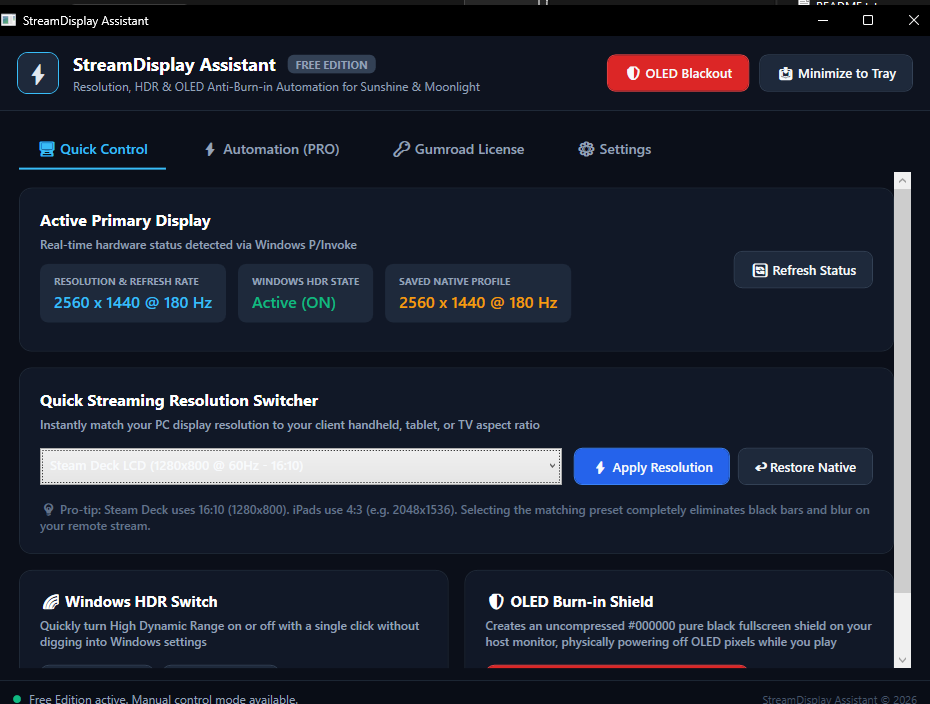

# ⚡ StreamDisplay Assistant

> **Zero-touch resolution adapter, Windows HDR switcher, host speaker auto-mute, and multi-monitor OLED burn-in shield for Sunshine, Moonlight, Steam Remote Play, and Parsec.**

[](https://microsoft.com)
[](https://dotnet.microsoft.com)
[-F85252.svg?logo=gumroad&logoColor=white)](https://gumroad.com)
[](https://github.com/Darkest831/StreamDisplay-Assistant/releases)
[](https://www.virustotal.com)

---

## 📸 Overview / Screenshot



---

## 🎯 What Does StreamDisplay Assistant Solve? (In 3 Lines)

1. **Eliminates Black Bars & Blurry Text**: Automatically matches your PC resolution to your remote device's exact aspect ratio (e.g. 1920x1440 @ 180Hz on iPad Air M2, 1920x1200 on Steam Deck) with crystal-clear rendering.
2. **Multi-Monitor OLED Burn-in Protection**: Blanks all physical host screens with pure `#000000` black (0 nits), completely powering down OLED subpixels to prevent burn-in and cut up to ~75W of active power.
3. **Zero-Touch Audio & Desktop Restoration**: Automatically mutes host PC speakers while streaming so they don't blast in your room, turns Windows HDR on/off, and seamlessly restores your native desktop upon disconnect.

---

## 📊 Feature Comparison: Free vs PRO Edition

StreamDisplay Assistant is built on a **fair, transparent model**: all manual tools and safety features are 100% free forever. The PRO license unlocks complete zero-touch background automation.

| Feature / Capability | Free Edition (Free Forever) | PRO Edition (€4.99 Lifetime) |
| :--- | :---: | :---: |
| **Instant Resolution Switcher** (16:9, 16:10, 4:3, Tablets, Handhelds, TV) | ✔ Yes | ✔ Yes |
| **Custom Resolution Creator** with permanent preset saving | ✔ Yes | ✔ Yes |
| **One-Click Windows HDR Toggle** (ON / OFF via DisplayConfig API) | ✔ Yes | ✔ Yes |
| **Multi-Monitor OLED Blackout Shield** (#000000 pure black across all screens) | ✔ Yes | ✔ Yes |
| **Global Emergency Hotkeys** (`Ctrl+Shift+F12` Restore, `Ctrl+Shift+F11` Blackout, `Ctrl+Shift+H` HDR, `Ctrl+Shift+M` Mute) | ✔ Yes | ✔ Yes |
| **System Tray Integration** (quiet background operation next to clock) | ✔ Yes | ✔ Yes |
| **Multi-Drive Streaming Discovery** (auto-detects Sunshine, Steam, Parsec, Moonlight, AnyDesk, RustDesk, TeamViewer, Chiaki, OBS) | ❌ | ✔ **Yes** |
| **Zero-Touch Background Automation** (automatically triggers upon stream connect) | ❌ | ✔ **Yes** |
| **Dynamic Auto-Adapt from Client** (reads incoming Moonlight/Sunshine resolution & applies best raster mode) | ❌ | ✔ **Yes** |
| **Host PC Audio Auto-Mute** (mutes speakers during stream, unmutes on disconnect) | ❌ | ✔ **Yes** |
| **Automatic Windows HDR Switching** (enables HDR on stream launch, disables on exit) | ❌ | ✔ **Yes** |
| **Automatic Native Desktop Restoration** (reverts exact native resolution on disconnect) | ❌ | ✔ **Yes** |
| **OLED Protection & Eco Analytics Dashboard** (tracks sessions, hours saved, and kWh saved) | ❌ | ✔ **Yes** |
| **Hardware DPAPI License Security** (encrypted offline license caching) | ❌ | ✔ **Yes** |
| **Lifetime Updates & New Features** | ❌ | ✔ **Yes** |

---

## 🛒 Unlock PRO Edition (€4.99)

Support independent software development and unlock zero-touch streaming automation for all your devices:

👉 **[Get StreamDisplay Assistant PRO on Gumroad (€4.99)](https://5888573439289.gumroad.com/l/streamdisplay_pro)** 👈

*Instant delivery • Lifetime license valid on up to 3 personal PCs • 100% money-back guarantee*

---

## ⌨️ Global Emergency Hotkeys

StreamDisplay Assistant includes system-wide hotkeys that work from inside any full-screen game or application:

| Shortcut | Action | Description |
| :--- | :--- | :--- |
| <kbd>Ctrl</kbd> + <kbd>Shift</kbd> + <kbd>F12</kbd> | **Emergency Native Restore** | Panic button: immediately forces display back to physical native resolution |
| <kbd>Ctrl</kbd> + <kbd>Shift</kbd> + <kbd>F11</kbd> | **Toggle OLED Blackout** | Instantly drops or removes the pure black OLED shield across all monitors |
| <kbd>Ctrl</kbd> + <kbd>Shift</kbd> + <kbd>H</kbd> | **Toggle Windows HDR** | Commutes Windows HDR on or off instantly |
| <kbd>Ctrl</kbd> + <kbd>Shift</kbd> + <kbd>M</kbd> | **Toggle Host Audio Mute** | Mutes or unmutes host master audio endpoint |

---

## 🛡️ 100% Native Architecture & Anti-Cheat Safety

- **Zero Third-Party Drivers**: Unlike virtual display driver tools, StreamDisplay Assistant does **not** install kernel-mode drivers or uncertified virtual displays.
- **Anti-Cheat Safe**: 100% compatible with kernel-level Anti-Cheat systems (**Riot Vanguard, EasyAntiCheat, BattlEye, Ricochet**). Zero risk of game bans.
- **Pure Win32 & Core Audio**: Built entirely with native Windows APIs (`user32.dll`, `dxgi.dll`, and `mmdeviceapi` COM).

---

## 📦 Download & Installation

1. Go to the [Releases](https://github.com/Darkest831/StreamDisplay-Assistant/releases) page.
2. Download `StreamDisplayAssistant_v1.0.0.zip`.
3. Extract the ZIP anywhere on your PC (e.g. `C:\Tools\StreamDisplayAssistant` or Desktop).
4. Run `StreamDisplayAssistant.exe`. **No installation or runtime required** — it is a single self-contained executable.

### Cryptographic Checksum & Verification
- **File**: `StreamDisplayAssistant.exe` (v1.0.0 Standalone Single-File)
- **SHA-256 (EXE)**:
  ```text
  3B4F90412FFBD38FBB0FF7C7A74169ECAA58043FFE37D9E4E09A1A865B46044D
  ```
- **SHA-256 (ZIP Package)**:
  ```text
  D44A25DF446C7C4BF8F94FE99AB8D46940BE0ACA2311589F211875F7BDFEED6A
  ```
- **VirusTotal Report**: [Verify on VirusTotal](https://www.virustotal.com)

---

## 🇮🇹 Sintesi in Italiano

**StreamDisplay Assistant** è lo strumento definitivo per chi gioca in streaming dal proprio PC a iPad Air/Pro, Steam Deck, ROG Ally o smartphone tramite Sunshine, Moonlight, Steam Remote Play o Parsec.
- **Addio barre nere**: Seleziona automaticamente la massima risoluzione compatibile con le proporzioni del tuo schermo (es. 1920x1440 @ 180Hz su iPad 4:3).
- **Protezione Schermi OLED**: Spegne i pixel (#000000 puro a 0 nit) su tutti i monitor del PC host mentre giochi dal divano, azzerando il rischio di burn-in.
- **Automazione Totale (Versione PRO)**: Silenzia le casse del PC fisso all'avvio dello stream, attiva l'HDR e ripristina la tua risoluzione nativa appena ti disconnetti.

---

## 📄 License & Credits

- StreamDisplay Assistant © 2026. All rights reserved.
- Gumroad product distribution & PRO license verification via official Gumroad v2 API.
